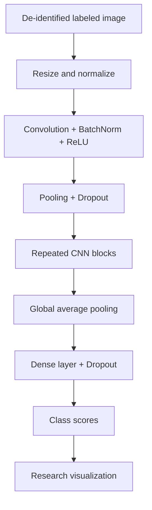

# Computer-Aided Medical Image Diagnosis using Regularized Convolutional Neural Networks

An educational research prototype that classifies labeled medical images using a custom CNN with dropout, batch normalization, data augmentation, AdamW weight decay, and early stopping. Includes a Streamlit image-upload interface, training script, checkpointing, and unit tests.

> **Safety notice:** This is not a clinically validated medical device. Predictions are research outputs only and must not be used to diagnose, treat, or rule out a medical condition. Consult a qualified healthcare professional.

## Features

- Regularized CNN with three convolutional blocks.
- Dropout / spatial dropout and batch normalization.
- AdamW optimizer with configurable weight decay.
- Image augmentation and validation-loss early stopping.
- Saves the best validation checkpoint and training history.
- Streamlit UI for image upload and class-score visualization.
- Pytest unit tests and architecture notes.

## Project structure

```text
road-scene-yolo/
├── medical_app.py
├── medical_cnn/
│   ├── __init__.py
│   └── model.py
├── scripts/
│   └── train_medical.py
├── tests/
│   └── test_medical_model.py
├── docs/
│   └── medical-cnn-architecture.md
├── data/
│   └── medical_images/
│       ├── train/<class_name>/
│       └── val/<class_name>/
├── artifacts/                 # generated checkpoints (do not commit)
└── requirements-medical.txt
```

The original road-scene YOLOv8 implementation remains on the `main` branch. This medical-image implementation is on the `medical-image-diagnosis` branch for review.

## Setup

Python 3.10 or newer is recommended.

```bash
git clone https://github.com/Praveen5722/road-scene-yolo.git
cd road-scene-yolo
git checkout medical-image-diagnosis
python -m venv .venv
```

Activate the environment:

```bash
# Windows PowerShell
.venv\Scripts\Activate.ps1

# Linux / macOS
source .venv/bin/activate
```

Install dependencies:

```bash
python -m pip install --upgrade pip
pip install -r requirements-medical.txt
```

## Prepare the dataset

Use a properly licensed, de-identified dataset suitable for your research objective. Organize images into class-named directories:

```text
data/medical_images/
├── train/
│   ├── class_a/
│   └── class_b/
└── val/
    ├── class_a/
    └── class_b/
```

Replace `class_a` and `class_b` with the dataset's real label names. Train and validation folders must have the same class directories. Do not use this example as a claim that any particular dataset or disease is supported by default.

**Avoid data leakage:** where patient identifiers are available, split data by patient, not by individual image. Keep a separate held-out test set for final evaluation. Never upload identifiable medical images to public repositories.

## Train

```bash
python scripts/train_medical.py --data data/medical_images --epochs 20 --batch-size 32 --weight-decay 0.0001 --dropout 0.4
```

The best checkpoint is saved to `artifacts/medical_cnn.pt`, with a history file at `artifacts/medical_cnn.history.json`. The script selects the checkpoint with the lowest validation loss and supports early stopping. It automatically uses CUDA when available, otherwise CPU.

## Run the web app

After training:

```bash
streamlit run medical_app.py
```

Upload a supported PNG, JPG, JPEG, or BMP image. The app displays the highest-scoring dataset label and the model's class scores. Scores are not calibrated clinical probabilities and are not evidence of diagnostic accuracy.

## Tests

```bash
pytest -q tests/test_medical_model.py
```

## Architecture



See [docs/medical-cnn-architecture.md](docs/medical-cnn-architecture.md) for details.

## Evaluation guidance

For a meaningful research report, evaluate on a patient-independent held-out test set and report class-wise precision, recall, F1-score, confusion matrix, sensitivity, specificity, calibration, confidence intervals, and subgroup performance. Compare with a simple baseline and document dataset limitations. Do not invent or claim performance numbers before running experiments.

## Limitations and responsible use

- The model is trained from scratch and requires a suitable labeled dataset.
- Performance depends on data quality, population, imaging modality, labels, and acquisition conditions.
- A softmax score is not a calibrated probability of disease.
- The prototype has not undergone clinical validation, regulatory review, or prospective testing.
- Use appropriate data governance, ethics approval, and privacy safeguards for real medical data.

## License

The repository's existing license applies subject to its terms. Verify dataset and dependency licenses before redistribution or commercial use.
